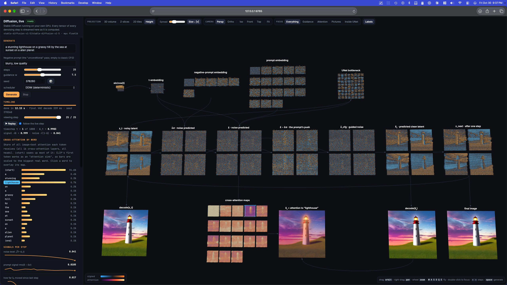
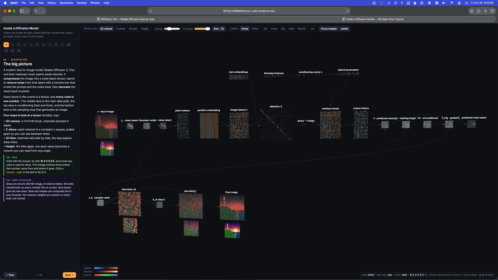

# Learning about diffusion

Two interactive 3D tours of how text-to-image diffusion models work. Every number in every
tensor is drawn as a cube, so you can watch data flow through the model.

| | what | needs |
|---|---|---|
| [`diffusion-walk.html`](diffusion-walk.html) | **Guided tutorial.** A small latent diffusion transformer (SD3/Flux-style: DiT, rectified flow, velocity prediction) computed in the browser, in 14 chapters from pixels to the final image. The weights are toy weights, but the shapes and the data flow are faithful. | just a browser |
| [`live/`](live/) | **The real thing.** Stable Diffusion 1.5 running locally on the GPU, streaming every tensor of every denoising step to a 3D viewer: latents, noise predictions, guidance, x̂₀, cross-attention maps per word, timestep embeddings, and previews. | Python 3.10–3.12, [uv](https://docs.astral.sh/uv/), an Apple Silicon Mac (or a CUDA GPU) |

### Live viewer



The live viewer after a finished 25-step run, in **Height** projection with every tensor in
focus. The overlay shows where the model attends to the word "lighthouse".

### Guided tutorial



The walk-through's opening chapter (00 · Orientation) in **3D volume** projection. It shows
the whole pipeline: the main data path in the middle, conditioning on top and the sampling loop
below.

## Quick start

```bash
# the tutorial
open diffusion-walk.html

# the live version (first run downloads ~2 GB of weights to ~/.cache/huggingface)
cd live
uv run server.py
open http://127.0.0.1:8765
```

See [`live/README.md`](live/README.md) for how the live server works, the wire format and the
options.

## Layout

```
diffusion-walk.html     self-contained tutorial (Three.js from a CDN)
live/
  server.py             FastAPI + WebSocket server, binary tensor streaming
  sd_probe.py           hand-written SD sampling loop with probes on the UNet internals
  web/index.html        the live 3D viewer
  pyproject.toml        dependencies (uv.lock pins exact versions)
```
